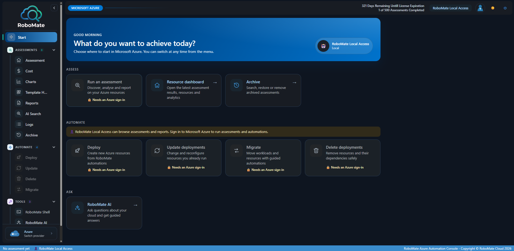
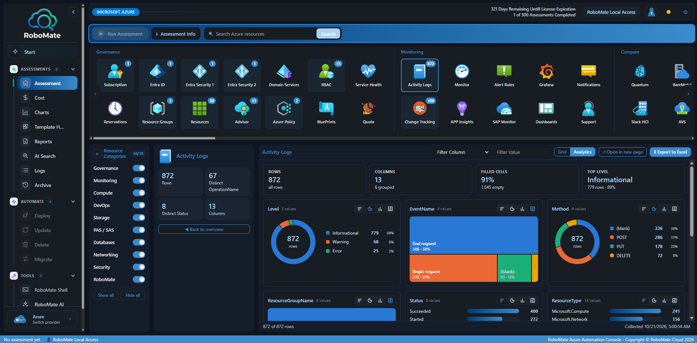
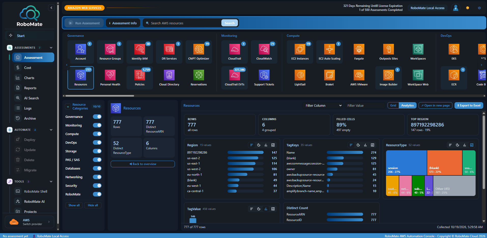
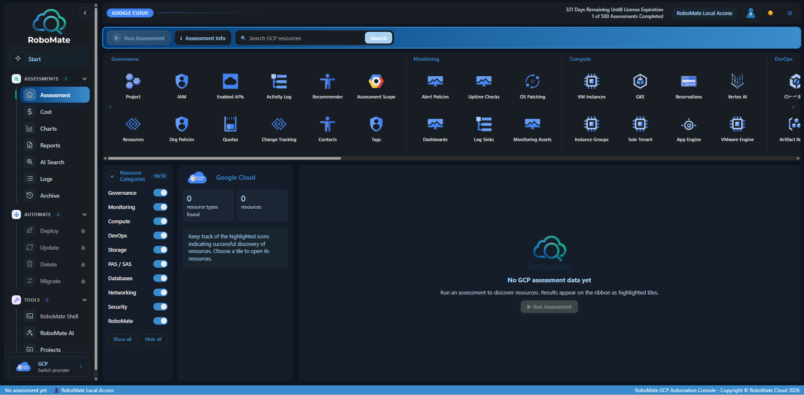
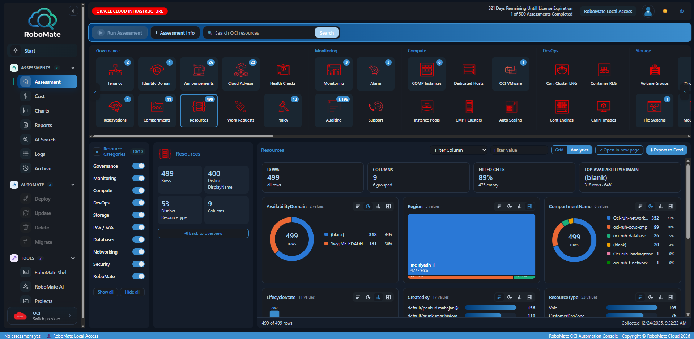
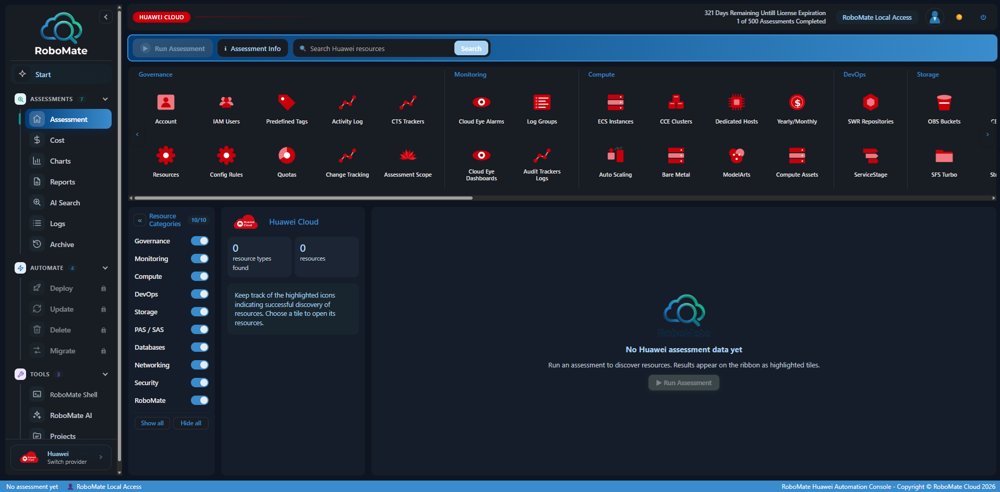
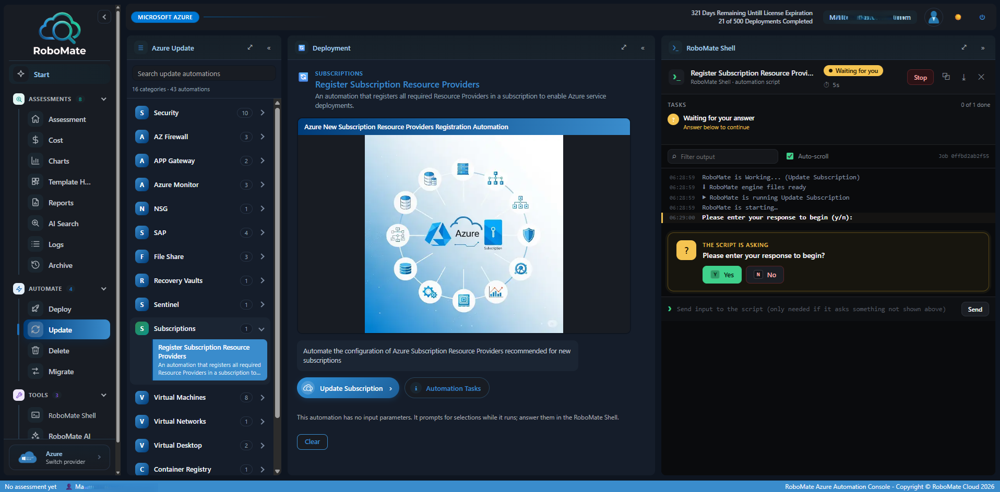

 

  

<h1 align="center"><strong>RoboMate Cloud Automation</strong></h1>

  <strong>Multi-Cloud Assessment, Security, Optimization & Automation</strong>

  Developed by <strong>Marco Fekry</strong> | Multi-Cloud Consultant

  <a href="https://www.robomatecloud.com">Official Website</a> |
  <a href="https://linkedin.com/company/robomate-cloud-automation">LinkedIn</a> |
  <a href="https://github.com/MarcoFekry/RoboMate-CloudAutomation">GitHub</a>

  

# Overview

RoboMate Cloud Automation is an integrated cloud engineering solution designed to simplify infrastructure assessment, improve security, optimize cloud expenditure, and accelerate technical delivery across multi-cloud environments.

Combining assessment profiles, automation workflows, reporting, and RoboMate Tools, the platform helps cloud professionals reduce repetitive engineering tasks and deliver consistent, insight-driven results.

**Key capabilities include:**

- **Cloud Assessment:** Infrastructure inventory, configuration analysis, security reviews, and business continuity assessments.
- **Cost Optimization:** Resource utilization analysis and identification of potential cost-saving opportunities.
- **Security and Governance:** Assessment against supported cloud security standards and frameworks.
- **Cloud Automation:** Infrastructure deployment, landing zones, monitoring, auditing, migration, and security hardening.
- **Presales Automation:** Support for preparing customer-specific technical scopes of work using RoboMate Tools.
- **Microsoft Security:** Supported Microsoft Entra ID and Microsoft 365 security and compliance assessments.

## Supported Platforms

RoboMate supports assessment and automation scenarios across the following platforms, depending on the selected module and available capabilities:

- Microsoft Azure
- Amazon Web Services (AWS)
- Google Cloud Platform (GCP)
- Huawei Cloud
- Oracle Cloud Infrastructure (OCI)
- Microsoft Entra ID and Microsoft Office 365

  

  

  

  

  

  

# Assessment Profile

Evaluate cloud environments and generate structured reports to improve infrastructure visibility, security posture, and operational efficiency.

**Available assessment categories:**

- **Resource Inventory:** Discover and review cloud infrastructure assets and configurations.
- **Cost Optimization:** Identify potential resource inefficiencies and cost-saving opportunities.
- **Business Continuity:** Review supported availability, backup, and disaster recovery configurations.
- **Cloud-Native Security:** Identify potential security misconfigurations using supported security frameworks.
- **RoboMate Security:** Provide additional security-focused assessment insights.
- **Entra ID and Microsoft 365 Security:** Assess supported identity, access, and compliance configurations.
- **CISA Security Assessments:** Evaluate supported configurations against applicable CISA recommendations.

Assessment coverage depends on the selected provider, permissions, enabled modules, and available configuration data.

# Automation Profile

Accelerate cloud engineering through predefined workflows and supported deployment capabilities.

**Core automation capabilities:**

- **Workload Deployment:** Automate supported multi-step cloud implementation activities.
- **Landing Zones and Architecture:** Deploy supported cloud foundations and architectural configurations.
- **Monitoring and Auditing:** Implement supported monitoring and auditing solutions.
- **Resource Migration:** Support eligible resource migrations within the same cloud provider.
- **Security Hardening:** Apply supported cloud security configurations and recommendations.

  

Automation requirements, prerequisites, and outcomes vary according to the selected cloud platform, workflow, and target environment.

# Presales and Scope of Work Automation

RoboMate Tools helps presales engineers, cloud consultants, and solution architects streamline the preparation of customer-specific scopes of work (SOWs) for cloud projects and professional services engagements.

By supporting the translation of customer requirements into structured technical activities, RoboMate helps connect presales planning with practical implementation and automation capabilities.

**Key capabilities:**

- **Requirements Analysis:** Organize customer requirements into technical workstreams and implementation activities.
- **Automated Scope Preparation:** Support the creation of structured, customer-specific scopes of work.
- **Multi-Cloud Scoping:** Support projects across applicable cloud providers and Microsoft platforms.
- **Delivery Planning:** Structure activities, deliverables, prerequisites, dependencies, assumptions, and exclusions.
- **Effort Estimation Support:** Help organize implementation tasks for technical effort estimation and project planning.
- **Automation Mapping:** Identify activities that align with available RoboMate automation tools and workflows.

**Typical use cases:** Cloud migration, landing zones, security hardening, monitoring, governance, cost optimization, Microsoft security, and infrastructure deployment.

**Business value:** Reduce repetitive presales effort, improve documentation consistency, accelerate proposal preparation, and establish clearer boundaries between project scope and delivery responsibilities.

All generated or assembled scopes, estimates, and customer commitments should be validated by the responsible technical and commercial stakeholders before submission.

# Who Is It For?

RoboMate Cloud Automation is designed for:

- Cloud architects and consultants
- Cloud engineers and administrators
- DevOps and platform engineering teams
- Security and governance professionals
- FinOps and cloud operations teams
- Presales engineers and managed service providers

The platform helps teams improve visibility, standardize recurring activities, and accelerate customer delivery across supported cloud environments.

# System Requirements

| Component | Minimum Requirement |
|---|---|
| Operating system | Windows 10 / Windows 11 |
| Windows Server | 2019, 2022, or 2025 |
| Processor | 4 CPU cores |
| Memory | 8 GB RAM |
| Storage | 2 GB available disk space |
| Display scaling | 100% recommended |

Additional resources may be required for large-scale assessments and reporting workloads.

# Prerequisites

- Local administrator permissions for installation and operations requiring elevation.
- A valid RoboMate Cloud Automation license.
- Appropriate authentication and permissions for the target cloud environments.
- Network access to required cloud services and endpoints.
- Any additional dependencies required by the selected modules.

# Installation and Getting Started

1. Download `RoboMate-Installer.zip` from the authorized distribution source.
2. Extract the installation package to a local directory.
3. Run `RoboMateInstall.exe` with the required permissions.
4. Activate your RoboMate Cloud Automation license.
5. Follow the installation wizard to complete setup.
6. Launch RoboMate Cloud Automation.
7. Authenticate to the required cloud providers and Microsoft services.
8. Select the appropriate assessment, automation, or presales workflow.

# Important Notes

- Review assessment findings before implementing remediation or configuration changes.
- Validate automation prerequisites, permissions, and potential operational impact before execution.
- Protect credentials, authentication tokens, license information, and assessment reports.
- Product functionality depends on the installed version, license, enabled modules, and supported provider capabilities.

# Get Started with RoboMate

Explore the platform, request a trial license, or discuss your cloud assessment, automation, and presales requirements through the official website.

  <a href="https://www.robomatecloud.com"><strong>Visit the Official Website</strong></a>

  <strong>RoboMate Cloud Automation</strong> 
  Transforming Cloud Complexity into Actionable Insights and Repeatable Automation.

  Developed by Marco Fekry

