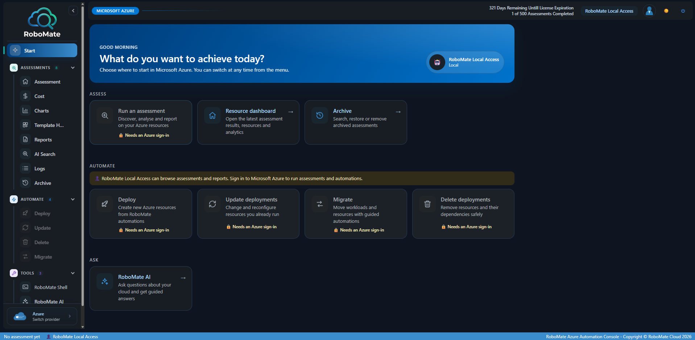
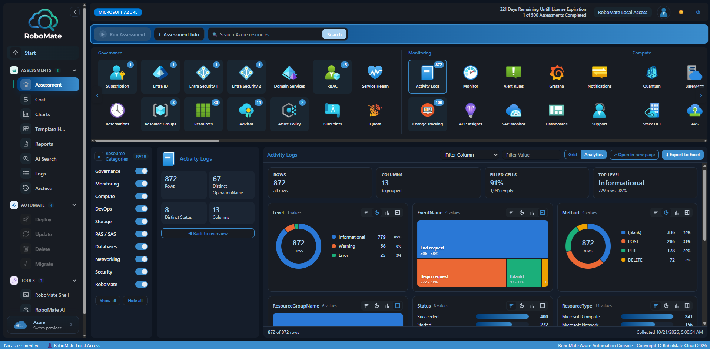
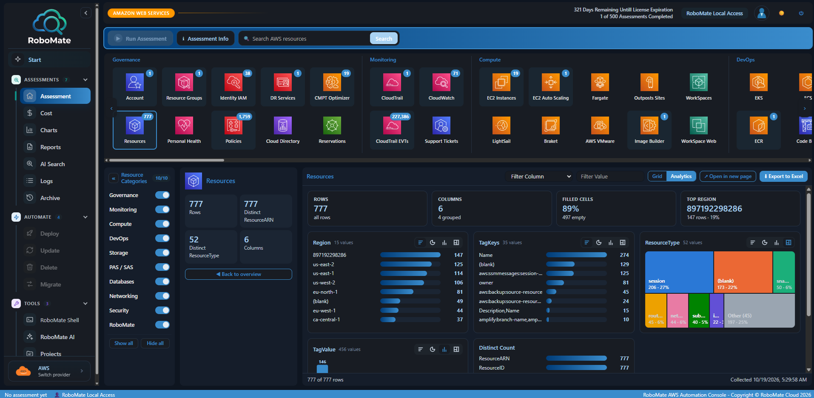
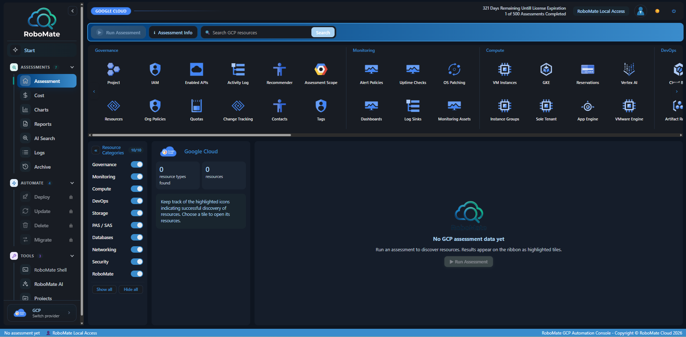
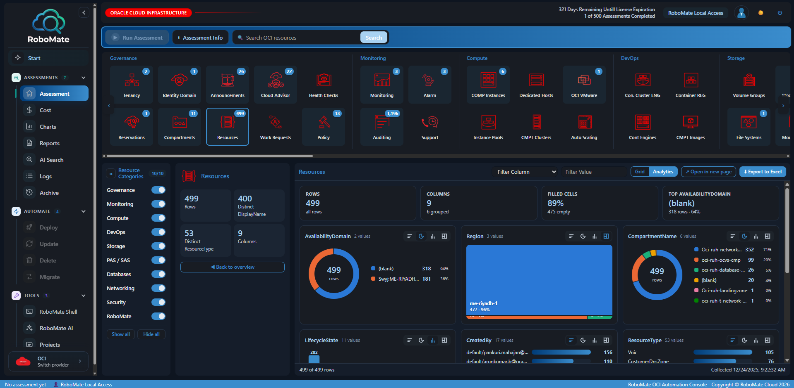
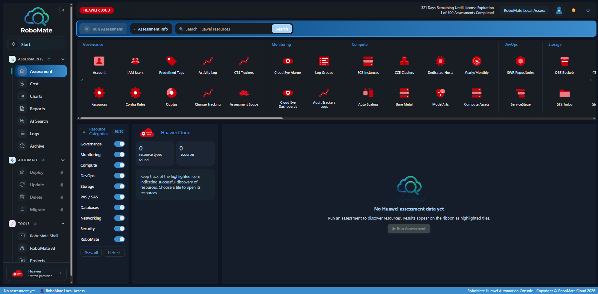
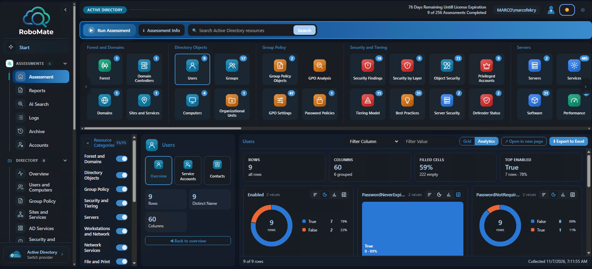
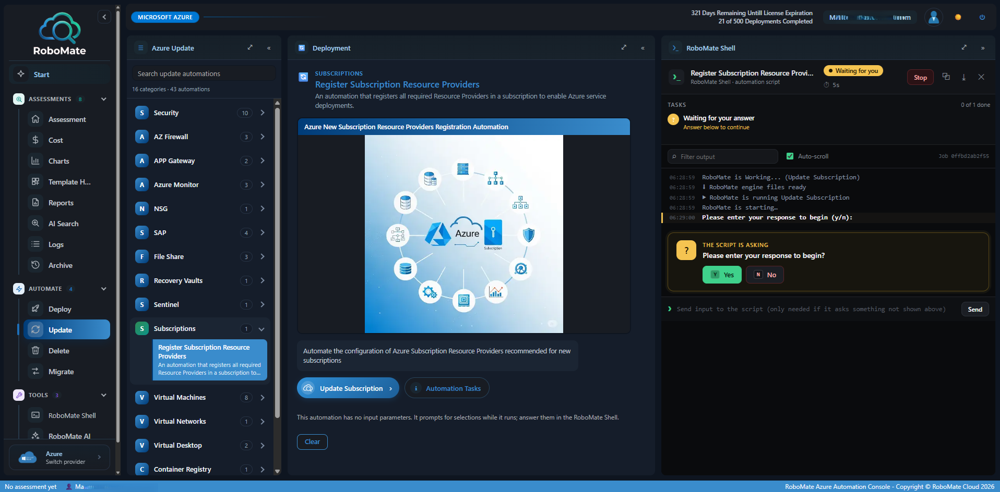

 

  

<h1 align="center"><strong>RoboMate Cloud Automation</strong></h1>

  <strong>Multi-Cloud and Active Directory Assessment, Security, Compliance, Optimization & Automation</strong>

  Developed by <strong>Marco Fekry</strong> | Multi-Cloud Consultant

  <a href="https://www.robomatecloud.com">Official Website</a> |
  <a href="https://linkedin.com/company/robomate-cloud-automation">LinkedIn</a> |
  <a href="https://github.com/MarcoFekry/RoboMate-CloudAutomation">GitHub</a>

  

# Overview

RoboMate Cloud Automation is an integrated multi-cloud engineering solution designed to simplify infrastructure assessment, improve security, prove compliance, optimize cloud expenditure, and accelerate technical delivery across multi-cloud and on-premises environments.

Combining assessment profiles, automation workflows, compliance reporting, scheduled assessments, RoboMate Hub, and RoboMate AI, the platform helps cloud professionals reduce repetitive engineering tasks and deliver consistent, insight-driven results, all from one web console.

**Key capabilities include:**

- **Cloud Assessment:** Infrastructure inventory, configuration analysis, security reviews, dependencies, and business continuity assessments.
- **Active Directory Assessment:** On-premises Active Directory, Group Policy, AD tiering, Windows Server roles, Exchange, SharePoint, System Center, Hyper-V, web servers, and databases.
- **Compliance:** 18 standards and 3,306 requirements evaluated for every cloud, with daily online rule updates.
- **Cost Optimization:** Resource utilization analysis and identification of potential cost-saving opportunities.
- **Security and Governance:** Assessment against supported cloud security standards, CISA baselines, and Microsoft benchmarks.
- **Cloud Automation:** Infrastructure deployment, landing zones, monitoring, auditing, migration, and security hardening.
- **Scheduled Tasks:** Assessments of any provider on a one-time or repeating schedule.
- **Presales Automation:** 78 RoboMate Hub offerings that prepare customer-specific scopes of work and man-day estimates.
- **Microsoft Security:** Microsoft Entra ID and Microsoft 365 security and compliance assessments, including Intune.

## Supported Platforms

The RoboMate **Cloud Providers** screen has eight items, four in each row:

| | | | |
|---|---|---|---|
| Microsoft Azure | Amazon Web Services (AWS) | Oracle Cloud Infrastructure (OCI) | Google Cloud Platform (GCP) |
| Huawei Cloud | Microsoft Entra ID and Office 365 | **Active Directory** (on-premises) | **Scheduled Tasks** |

Assessment and automation scenarios depend on the selected module, license, and available capabilities.

  

  

  

  

  

  

  

# Assessment Profile

Evaluate cloud and on-premises environments and generate structured reports to improve infrastructure visibility, security posture, compliance, and operational efficiency.

**Available assessment categories:**

- **Resource Inventory:** Discover and review cloud infrastructure assets, configurations, and dependencies (Google Cloud includes organization discovery).
- **Cost Optimization:** Identify potential resource inefficiencies and cost-saving opportunities.
- **Business Continuity:** Review supported availability, backup, and disaster recovery configurations.
- **Cloud-Native Security:** Identify potential security misconfigurations using supported security frameworks.
- **RoboMate Security:** Provide additional security-focused assessment insights and recommendations.
- **Compliance Reports:** One report with all standards and one per standard for every cloud, built from the current assessment.
- **Entra ID and Microsoft 365 Security:** Assess identity, access, Exchange Online, SharePoint, Teams, Defender, Purview, Power Platform, and Intune configurations.
- **CISA Security Assessments:** Evaluate configurations against the CISA SCuBA baselines, evaluated by RoboMate itself.
- **Active Directory:** Assess on-premises identity and the Windows Server estate (see below).

Assessment coverage depends on the selected provider, permissions, enabled modules, and available configuration data.

# Active Directory Assessment

RoboMate assesses on-premises Active Directory with the same experience as the cloud providers: sign-in, live progress, tiles, grids, modern charts and gauges, reports, RoboMate Hub, and RoboMate AI Search.

**Views:**

- **Active Directory Users and Computers:** the same tree as the MMC console, with every object and attribute.
- **Group Policy:** every GPO, link, filter, and setting, with full Group Policy analysis and fine-tuning recommendations.
- **Tiering and Privileged Access:** Tier 0 / 1 / 2 assets and accounts, privileged groups, delegation, and paths to Tier 0.
- **Active Directory Services:** AD DS, AD LDS, AD FS, AD CS, AD RMS, AD Web Services, Global Catalog, and domain controllers.
- **Network Services:** DNS, DHCP, IPAM, NPS, RRAS, and network infrastructure services.
- **File and Storage Services:** SMB shares and permissions, DFS Namespaces and Replication, FSRM, storage, and clusters.
- **Remote Access and Application Services:** RDS roles and licensing, IIS, WDS, print servers, and printers.
- **Additional Services:** KMS and volume activation, WSUS, Failover Clustering, Hyper-V, Windows Server Backup, Time Service, Event Forwarding, and Defender services.
- **Exchange, SharePoint, and System Center:** dedicated views with objects, security, performance, and utilization.
- **Hyper-V and Failover Clustering:** hosts, utilization, VMs, VM performance, clusters, and quorum.
- **Web Servers (IIS) and Databases (SQL Server):** discovered servers with full details and performance.
- **Server Performance:** CPU, memory, network, disk IO, disk speed, and disk space gauges for at least the 7 days before the assessment.
- **Inventory:** hardware, software, services, roles, and open ports of every server and workstation.
- **Network Communication Map:** server-to-server and server-to-service communication with port mapping.
- **OS Updates and Builds, Missing Updates, Licensing and Activation, Defender Status, Auditing, and Compliance** (Microsoft Security Baselines, CIS Windows Server Benchmarks, and the RoboMate rule pack).
- **RoboMate Recommendations:** management, best practices, object actions, Group Policy fine-tuning, and security recommendations for each area.

**Multi-level permissions:** add one account per assessment area (Tier 0 domain, Tier 1 servers, Tier 2 workstations, Exchange, SharePoint, SQL Server, System Center), so every part of the assessment runs with the least privilege it needs.

**Before the first assessment:** run RoboMate on a domain-joined machine, enable WinRM and WMI on the servers, keep 7 days of performance counter history, and allow LDAP, Kerberos, DNS, SMB, RPC, and Active Directory Web Services to the domain controllers. The built-in documentation lists every port and account.

# Scheduled Tasks

Run the assessments of Azure, AWS, OCI, Google Cloud, Huawei Cloud, Entra ID and Office 365, and Active Directory on a schedule, using the access saved on each provider's sign-in page.

- One-time runs or repeating intervals with one or more run times per day, week, or month.
- The tenant, subscription, account, project, region, or domain and the access used are shown for every task.
- Run and stop controls, running jobs with live progress, logs, completion time, and duration.
- Jump straight to the provider assessment view of a finished run.

# Compliance

Every cloud has a **Compliance Reports** group: CIS Foundations Benchmarks per cloud, NIST SP 800-53, NIST CSF 2.0, ISO/IEC 27001, SOC 2, PCI DSS, HIPAA, GDPR, CSA CCM, CIS Controls, Essential Eight, NIS2, NIST SP 800-171, CMMC, FedRAMP 20x, DORA, UK Cyber Essentials, and AWS Foundational Security Best Practices.

Each requirement shows Passed, Failed, Manual review, or Not applicable, with the evidence, affected resources, and the fix. Rules update online every day from the RoboMate rule pack and official sources. Requirement-to-control mapping guides remediation and is not a certification.

# Automation Profile

Accelerate cloud engineering through predefined workflows and supported deployment capabilities.

**Core automation capabilities:**

- **Workload Deployment:** Automate supported multi-step cloud implementation activities.
- **Landing Zones and Architecture:** Deploy supported cloud foundations and architectural configurations.
- **Monitoring and Auditing:** Implement supported monitoring and auditing solutions.
- **Resource Migration:** Support eligible resource migrations within the same cloud provider.
- **Security Hardening:** Apply supported cloud security configurations and recommendations.

  

Automation requirements, prerequisites, and outcomes vary according to the selected cloud platform, workflow, and target environment.

# Presales and Scope of Work Automation

RoboMate Hub helps presales engineers, cloud consultants, and solution architects streamline the preparation of customer-specific scopes of work (SOWs) for cloud projects and professional services engagements.

**78 RoboMate Hub offerings across Azure, AWS, OCI, Google Cloud, and Huawei Cloud**, with Active Directory offerings in the same style: landing zones, migration, disaster recovery, backup and recovery, security hardening, compliance standards, cloud audit, modernization, networking and hybrid connectivity, identity and governance, monitoring and operations, FinOps, Kubernetes platforms, DevOps and IaC, Well-Architected reviews, Microsoft Sentinel, Azure Virtual Desktop, and resource templates.

**Key capabilities:**

- **Requirements Analysis:** Organize customer requirements into technical workstreams and implementation activities.
- **Automated Scope Preparation:** Support the creation of structured, customer-specific scopes of work.
- **Multi-Cloud Scoping:** Support projects across applicable cloud providers, Microsoft platforms, and Active Directory.
- **Delivery Planning:** Structure activities, deliverables, prerequisites, dependencies, assumptions, and exclusions.
- **Effort Estimation Support:** Man-day estimates per phase for technical effort estimation and project planning.
- **Automation Mapping:** Identify activities that align with available RoboMate automation tools and workflows.

**Typical use cases:** Cloud migration, landing zones, security hardening, monitoring, governance, cost optimization, Microsoft security, Active Directory modernization, and infrastructure deployment.

**Business value:** Reduce repetitive presales effort, improve documentation consistency, accelerate proposal preparation, and establish clearer boundaries between project scope and delivery responsibilities.

All generated or assembled scopes, estimates, and customer commitments should be validated by the responsible technical and commercial stakeholders before submission.

# RoboMate Tools and AI

- **Tools panel** in every console: RoboMate Hub, RoboMate Shell, RoboMate AI, Certificate Tools, Network Tools, and Projects.
- **13 Network Tools:** Internet speed, IP geolocation, DNS lookup, trace route, ping, port check, SSL/TLS certificate, HTTP headers, WHOIS, public IP, MTU finder, mail DNS check, and subnet calculator.
- **Certificate Tools:** PFX, PEM, CRT, CER, and KEY conversions and self-signed certificates.
- **RoboMate AI:** AI Search over every assessment and the RoboMate AI assistant, with formatted answers.
- **Export to PDF** of every report.

# Who Is It For?

RoboMate Cloud Automation is designed for:

- Cloud architects and consultants
- Cloud engineers and administrators
- Active Directory and Windows Server administrators
- DevOps and platform engineering teams
- Security, compliance, and governance professionals
- FinOps and cloud operations teams
- Presales engineers and managed service providers

The platform helps teams improve visibility, standardize recurring activities, and accelerate customer delivery across supported cloud and on-premises environments.

# System Requirements

| Component | Minimum Requirement |
|---|---|
| Operating system | Windows 10 / Windows 11 |
| Windows Server | 2019, 2022, or 2025 |
| Processor | 4 CPU cores |
| Memory | 8 GB RAM |
| Storage | 2 GB available disk space |
| Display scaling | 100% recommended |
| Browser | Microsoft Edge or Google Chrome |
| Web console | Local port 5080 (HTTPS) |

Additional resources may be required for large-scale assessments and reporting workloads.

# Prerequisites

- Local administrator permissions for installation and operations requiring elevation.
- A valid RoboMate Cloud Automation license.
- Appropriate authentication and permissions for the target cloud environments and Active Directory areas.
- Network access to required cloud services and endpoints, and to the domain controllers and servers for Active Directory.
- ASP.NET Core 8 and Windows Desktop 8 runtimes, PowerShell 7, the cloud modules, and the RSAT modules for Active Directory (installed by the installer for the providers in your license).

# Installation and Getting Started

1. Download `RoboMate-Installer.zip` from the authorized distribution source.
2. Extract the installation package to a local directory.
3. Run `RoboMateInstall.exe` with the required permissions.
4. Activate your RoboMate Cloud Automation license.
5. Follow the installation wizard to complete setup; it installs the prerequisites for the providers in your license.
6. Launch **RoboMate Console**. It opens the web console at `https://RoboMateCloudAutomation:5080` and keeps running in the system tray.
7. Authenticate to the required cloud providers, Microsoft services, or Active Directory.
8. Select the appropriate assessment, automation, scheduled task, or presales workflow.

Updates are checked when RoboMate Console starts and every hour; required updates install before RoboMate opens.

# Important Notes

- Review assessment findings before implementing remediation or configuration changes.
- Validate automation prerequisites, permissions, and potential operational impact before execution.
- Protect credentials, authentication tokens, license information, and assessment reports.
- Compliance reports guide remediation and are not a certification.
- Product functionality depends on the installed version, license, enabled modules, and supported provider capabilities.

# Get Started with RoboMate

Explore the platform, request a trial license, or discuss your cloud assessment, automation, and pre-sales requirements through the official website.

  <a href="https://www.robomatecloud.com"><strong>Visit the Official Website</strong></a>

  <strong>RoboMate Cloud Automation</strong> 
  Transforming Cloud Complexity into Actionable Insights and Repeatable Automation.

  Developed by Marco Fekry

